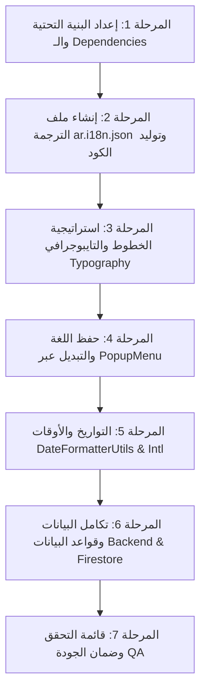

# 🌐 خطة تعريب تطبيق Doctor Hunt (دعم اللغة العربية)

تعتمد هذه الخطة على استخدام حزمة **`slang`** و **`slang_flutter`** مع تكامل **`flutter_localizations`** لتوفير تجربة مستخدم عربية متكاملة وسلسة.

---

## 📌 نظرة عامة على الوضع الحالي
* **الترجمة الحالية:** التطبيق يعتمد على `slang` ويستخدم المتغير العام `t` في الشاشات والـ Blocs والـ Exceptions، مع وجود ملف أساسي `assets/i18n/en.i18n.json`.
* **دعم البيانات الثنائية:** موديل التخصصات [`SpecialtyModel`](file:///E:/flutter/assignments/doctor_hunt/lib/apps/features/common/specialties/data/models/specialty_model.dart) مجهز مسبقاً بحقلي `ar` و `en` وتفحص دالة `localizedName()` كود اللغة الحالية.
* **المهام المؤجلة:** تم فصل تحسينات اتجاه الواجهات (RTL/Directionality) وضبط ارتفاع السطور إلى ملف مستقل: [`POSTPONED_RTL_AND_LAYOUT.md`](file:///E:/flutter/assignments/doctor_hunt/POSTPONED_RTL_AND_LAYOUT.md).

---

## 🗺️ مراحل التنفيذ



---

### المرحلة الأولى: إعداد البنية التحتية والاعتماديات (Infrastructure)

1. **إضافة حزمة `flutter_localizations`:**
   * تعديل ملف [`pubspec.yaml`](file:///E:/flutter/assignments/doctor_hunt/pubspec.yaml):
     ```yaml
     dependencies:
       flutter_localizations:
         sdk: flutter
     ```
   * **الهدف:** توفير الترجمة العربية للودجات الداخلية التابعة لـ Flutter نفسه (كالتقويم، منتقي الوقت، خيارات النسخ واللصق، وتلميحات الأزرار).

2. **تحديث شجرة التطبيق في [`lib/main.dart`](file:///E:/flutter/assignments/doctor_hunt/lib/main.dart):**
   * ربط `MaterialApp.router` مع `slang`:
     ```dart
     MaterialApp.router(
       locale: TranslationProvider.of(context).flutterLocale,
       supportedLocales: AppLocaleUtils.supportedLocales,
       localizationsDelegates: GlobalMaterialLocalizations.delegates,
       theme: AppTheme.lightTheme,
       routerConfig: appRouter,
     );
     ```

3. **تحديث إعدادات [`slang.yaml`](file:///E:/flutter/assignments/doctor_hunt/slang.yaml):**
   * إضافة `ar` في قائمة الـ `autodoc.locales`:
     ```yaml
     autodoc:
       enabled: true
       locales:
         - en
         - ar
     ```

---

### المرحلة الثانية: ملفات الترجمة والـ Slang Layer

1. **إنشاء ملف `assets/i18n/ar.i18n.json`:**
   * إنشاء الملف وترجمة كافة المفاتيح المتواجدة في `en.i18n.json` بصياغة عربية طبية دقيقة ومفهومة.
   * **الالتزام الصارم بقواعد الـ Skill (`skills/slang-i18n/SKILL.md`):**
     * كتابة المفاتيح بصيغة `snake_case` متطابقة تماماً مع الملف الإنجليزي.
     * الحفاظ على واجهات الـ Onboarding: `"pages(interface=PageData)"`.
     * الحفاظ على المتغيرات المحقونة مثل `{name}`, `{e}`, `{n}` بنفس أسمائها.
     * الحفاظ على خريطة أكواد الأخطاء `error.codes` لتتوافق مع معالجة استثناءات Firebase.

2. **دعم قواعد الجمع العربية (Pluralization):**
   * ضبط المفاتيح التي تحتوي على أعداد لتدعم صيغ الجمع الستة في العربية عند الحاجة (`zero`, `one`, `two`, `few`, `many`, `other`).

3. **توليد الكود البرمجي (Generation Command):**
   * تشغيل أمر الـ CLI الخاص بـ slang حصراً وتجنب استخدام `build_runner` لمنع التعارضات والمجلدات الزائدة:
     ```bash
     dart run slang
     ```

---

### المرحلة الثالثة: الخطوط والتايبوجرافي (Typography & Fonts)

1. **إضافة الخط العربي المحلي:**
   * تضمين خط عربي ملائم للتطبيقات الطبية وعصري (**Cairo**) كملف محلي في [`assets/fonts/`](file:///E:/flutter/assignments/doctor_hunt/assets/fonts/) وتعريفه في [`pubspec.yaml`](file:///E:/flutter/assignments/doctor_hunt/pubspec.yaml).

2. **الربط المركزي عبر ذرات التصميم ([`generate_styles.dart`](file:///E:/flutter/assignments/doctor_hunt/lib/generated/generate_styles.dart)):**
   * تحديث سكريبت توليد الخطوط لتوليد ذرات دلالية (Semantic Atoms):
     * `fontPrimary`: يتحول ديناميكياً إلى `Cairo` في العربية و `Rubik` في الإنجليزية اعتماداً على `LocaleSettings.currentLocale`.
     * `fontSecondary`: يتحول ديناميكياً إلى `Cairo` في العربية و `PlusJakartaSans` في الإنجليزية.
     * إتاحة `rubik` و `plusJakartaSans` كـ Aliases للتوافق مع أكثر من 600 استخدام حالي دون تعديل يدوي في الشاشات.
3. **تبسيط الثيم العام ([`AppTheme`](file:///E:/flutter/assignments/doctor_hunt/lib/apps/core/theme/app_theme.dart)):**
   * بقاء الثيم كـ `static lightTheme` بسيط، مع إضافة `fontFamilyFallback: const ['Cairo']` كشبكة أمان لعناصر النظام الافتراضية.

---

### المرحلة الرابعة: حفظ اللغة وتبديلها عبر PopupMenu (Language Switching & Persistence)

1. **طبقة التخزين المحلي [`UserPrefs`](file:///E:/flutter/assignments/doctor_hunt/lib/apps/core/data/shared_prefs/user_pref.dart):**
   * إضافة ثابت جديد في [`PrefsKeys`](file:///E:/flutter/assignments/doctor_hunt/lib/apps/core/data/shared_prefs/prefs_keys.dart):
     ```dart
     static const String languageKey = 'app_language_code';
     ```
   * إضافة دالتي الحفظ والقراءة في `UserPrefs`:
     ```dart
     Future<void> setLanguage(String languageCode) async {
       await _preferences.setString(PrefsKeys.languageKey, languageCode);
     }

     String getSavedLanguage() {
       return _preferences.getString(PrefsKeys.languageKey) ?? 'en';
     }
     ```

2. **التهيئة عند بدء تشغيل التطبيق في [`lib/main.dart`](file:///E:/flutter/assignments/doctor_hunt/lib/main.dart):**
   * استرجاع اللغة وتعيينها في `LocaleSettings` قبل أو أثناء تشغيل `runApp`:
     ```dart
     final savedLang = getIt<UserPrefs>().getSavedLanguage();
     LocaleSettings.setLocaleRaw(savedLang);
     ```

3. **بناء ودجت التبديل باستخدام `PopupMenuButton`:**
   * بناء ودجت قابلة لإعادة الاستخدام `LanguagePickerPopupMenu` تظهر قائمة منسدلة باللغات المدعومة:
     * English (الإنجليزية)
     * العربية (Arabic)
   * عند الاختيار:
     1. حفظ الكود في `UserPrefs`.
     2. استدعاء `LocaleSettings.setLocale(newLocale)`.
     3. إعادة بناء الواجهة لحظياً وتحديث النص المعروض فوراً.
   * دمج الودجت في:
     * إعدادات المريض: [`MoreOptionWidget`](file:///E:/flutter/assignments/doctor_hunt/lib/apps/features/patient/settings_tab/presentation/widget/more_option_widget.dart).
     * إعدادات الطبيب: [`DoctorAccountSettingsWidget`](file:///E:/flutter/assignments/doctor_hunt/lib/apps/features/doctor/doctor_settings_tab/widget/doctor_account_settings_widget.dart).
     * إعدادات الأدمن: [`AdminSettingsTab`](file:///E:/flutter/assignments/doctor_hunt/lib/apps/features/admin/admin_settings_tab/presentation/screens/admin_settings_tab.dart).

---

### المرحلة الخامسة: التواريخ والأوقات والأرقام (Dates & Times)

1. **تحديث [`DateFormatterUtils`](file:///E:/flutter/assignments/doctor_hunt/lib/apps/core/utils/date_formatter_utils.dart):**
   * إزالة الكلمات الإنجليزية الثابتة واستبدالها بنصوص الـ slang:
     * استبدال `"Today"` بـ `t.common.today`.
     * استبدال `"Tomorrow"` بـ `t.common.tomorrow`.
   * تمرير كود اللغة الحالية لمُنسق التواريخ:
     ```dart
     final locale = LocaleSettings.currentLocale.languageCode;
     final formattedDate = DateFormat('d MMM', locale).format(date);
     final dayName = DateFormat('EEEE', locale).format(date);
     ```

2. **تنسيق الفترات الزمنية (Time Slots):**
   * التأكد من عرض صباحاً ومساءً بشكل صحيح (ص / م أو AM / PM).

---

### المرحلة السادسة: البيانات الخارجية وقواعد البيانات (Backend & Firestore)

1. **التخصصات الطبية ([`SpecialtyModel`](file:///E:/flutter/assignments/doctor_hunt/lib/apps/features/common/specialties/data/models/specialty_model.dart)):**
   * الاعتماد على دالة `localizedName()` لجلب الاسم العربي `ar` أو الإنجليزي `en` تلقائياً وفقاً للـ `LocaleSettings.currentLocale.languageCode`.
2. **استعلامات البحث والفلترة:**
   * دعم فلترة والبحث عن التخصصات وأسماء الأطباء باللغة العربية.

---

### المرحلة السابعة: قائمة التحقق وضمان الجودة (QA Checklist)

* [x] **توليد الترجمات ومطابقة المفاتيح:** تم فحص `dart run slang analyze --full` وتأكيد تطابق مفاتيح اللغتين 100% بدون أي مفاتيح ناقصة (`"ar": {}`).
* [x] **تغيير اللغة الفوري:** تم التحقق من عمل `LanguagePickerPopupMenu` ومزامنة `LocaleSettings.setLocale` لإعادة بناء الواجهة فورياً بدون الحاجة لعمل Restart.
* [x] **استمرارية اللغة (Persistence):** حفظ اللغة واسترجاعها عبر `UserPrefs` وتهيئتها قبل `runApp` في `main.dart`.
* [x] **دعم التواريخ والتقويم:** تم استدعاء `initializeDateFormatting` بالتوازي مع Firebase، ومزامنة `Intl.defaultLocale` وتوطين `DateFormatterUtils`.
* [x] **التايبوجرافي والخطوط:** تم ربط خط Cairo المحلي كـ `fontPrimary` داخل `style_atoms.dart` وتوجيهه تلقائياً لكل استدعاءات `.rubik`.
* [x] **البحث الذكي والتخصصات:** تم إنشاء `SearchUtils` لتطبيع الحروف والتشكيل العربي وربط `localizedName()` مع Fallback آمن.
* [x] **فحص الـ Analyzer الشامل:** تم تشغيل `dart analyze` على المشروع بالكامل وجاءت النتيجة: `No issues found!` بنجاح تام.
