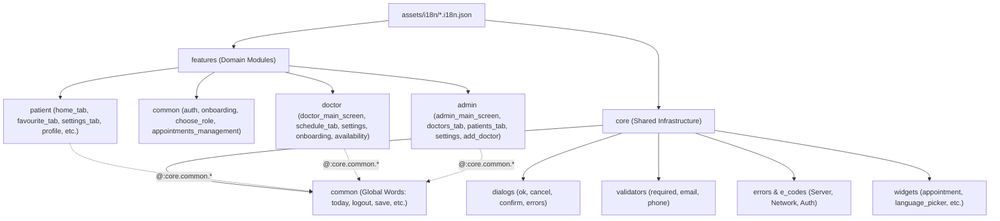

# 🌐 Flutter Slang (i18n) - Custom Skill & Best Practices

You are an expert Flutter developer. When working with translations and localizations in this project, you MUST adhere strictly to the following `slang` package guidelines:

---

## 1. Execution & Generation (Strict Rule)
- ❌ **DO NOT** use `slang_build_runner` or `build_runner` to generate translations. It causes conflicts and generates unwanted duplicate folders (e.g., `gen/`).
- ✅ **ALWAYS** use the standalone CLI command to generate or update translations:
  ```bash
  dart run slang
  ```
- ✅ **ALWAYS** run the full analyzer after editing translation files to ensure zero missing keys and keep translations in sync:
  ```bash
  dart run slang analyze --full
  ```

---

## 2. Configuration Standard (`../../slang.yaml`)
The project relies on a strictly configured `../../slang.yaml` file at the root. Do not alter these core rules unless explicitly asked:
- `key_case: camel`: Ensures all generated Dart getters are strictly `camelCase` to comply with Dart Clean Code standards.
- `key_map_case: snake`: Ensures keys inside specific `maps` (like backend error codes) retain their original `snake_case` format.
- `param_case: pascal`: Interpolated parameters in Dart must be called using `PascalCase` named arguments (e.g., `feeValue(Fee: '20')`, `welcome(Name: 'Ahmed')`).

---

## 3. Directory Mirroring Architecture (`lib/apps` ➔ JSON)

To maintain an intuitive 1:1 mental mapping, the JSON files (`assets/i18n/en.i18n.json` and `assets/i18n/ar.i18n.json`) **MUST strictly mirror** the directory structure of `lib/apps`:



### 3.1. Infrastructure & Shared: `core`
* `core.common`: Global repeated words (e.g. `today`, `tomorrow`, `email`, `password`, `phone`, `specialty`, `consultation_fee`, `save_changes`, `logout`, `active`, `inactive`, `enabled`, `disabled`, `see_all`, `search`, `build_version`, `app_version_val`).
* `core.dialogs`: Standard dialog actions (`ok`, `cancel`, `confirm`, `success`, `error`).
* `core.validators`: Form validation messages (`this_field_is_required`, `invalid_email_format`, `passwords_do_not_match`, etc.).
* `core.errors`: User-facing business & network error messages (`server_error`, `no_internet`, `user_not_authenticated`, etc.).
* `core.e_codes`: Raw backend/Firebase error codes (configured under `maps:` in `slang.yaml`).
* `core.widgets`: Texts used within shared global UI widgets:
  * `core.widgets.appointment`: Shared appointment cards and status chips (`upcoming`, `completed`, `canceled`, `fee_value`, `no_appointments_found`).
  * `core.widgets.status_switch_tile`: Status switch widget (`account_status`, `enabled`, `disabled`).
  * `core.widgets.language_picker`: Language switcher popup (`language`, `english`, `arabic`).

### 3.2. Domain Features: `features`
* `features.common`: Features shared across user roles:
  * `auth`: Login, sign up, forgot password screens and auth dialogs.
  * `onboarding`: Welcome and introduction slider pages.
  * `choose_role`: User role selection screen.
  * `appointments_management`: Shared appointments tab view.
* `features.patient`: Screens and widgets exclusive to Patient role (`main_screen`, `home_tab`, `favourite_tab`, `settings_tab`, `patient_profile_screen`, `doctor_details_screen`, `select_time_screen`, `privacy_policy_screen`).
* `features.doctor`: Screens and widgets exclusive to Doctor role (`doctor_main_screen`, `schedule_tab`, `doctor_settings_tab`, `doctor_profile_screen`, `doctor_onboarding_screen`, `doctor_availability_screen`).
* `features.admin`: Screens and widgets exclusive to Admin role (`admin_main_screen`, `admin_doctors_tab`, `admin_patients_tab`, `admin_settings_tab`, `admin_profile_screen`, `add_doctor_screen`, `doctor_details_screen`, `appointment_details_screen`).

---

## 4. Linked Translations & Zero Duplication (`@:key`)

Never duplicate common words or phrases across multiple screens. Always apply the **Single Source of Truth (DRY)** principle using slang's linked translations:

### ⚠️ CRITICAL RULE: Target Path Casing in Linked Translations
Because `key_case: camel` is active in `slang.yaml`, slang's internal AST normalizes all node names into `camelCase`.
* ❌ **INCORRECT (will fail compilation/analysis):**
  `"@:core.common.save_changes"` or `"@:core.widgets.appointment.no_appointments_found"`
* ✅ **CORRECT (always use camelCase in linked paths):**
  `"@:core.common.saveChanges"` or `"@:core.widgets.appointment.noAppointmentsFound"`

### Example of Linked Usage in JSON:
```json
{
  "core": {
    "common": {
      "save_changes": "Save Changes",
      "logout": "Logout",
      "consultation_fee": "Consultation Fee"
    }
  },
  "features": {
    "doctor": {
      "doctor_profile_screen": {
        "title": "Doctor Profile",
        "save_changes": "@:core.common.saveChanges",
        "consultation_fee": "@:core.common.consultationFee"
      }
    },
    "admin": {
      "add_doctor_screen": {
        "title": "Create Doctor",
        "consultation_fee": "@:core.common.consultationFee"
      }
    }
  }
}
```

---

## 5. JSON Files Convention (`.i18n.json`)
- **Naming:** Files must strictly follow the `<locale>.i18n.json` pattern (e.g., `assets/i18n/en.i18n.json` and `assets/i18n/ar.i18n.json`).
- **Keys Syntax:** All JSON keys **MUST** be written in pure `snake_case` (e.g., `welcome_back`, `forgot_password`, `user_name`). DO NOT use `camelCase` for keys inside the JSON files.
- **Strict Language Parity:** Whenever a key is added, modified, or linked in `en.i18n.json`, the exact same key hierarchy, variables, and links **MUST** be mirrored in `ar.i18n.json`. Verify this using `dart run slang analyze --full` (`_missing_translations.json` must be empty).

---

## 6. Dart Code Implementation
- Access translations using the global `t` variable.
- Access paths will naturally mirror `lib/apps/`:
  - `t.core.common.logout`
  - `t.core.dialogs.confirm`
  - `t.core.errors.serverError`
  - `t.core.widgets.appointment.feeValue(Fee: '20')`
  - `t.features.patient.homeTab.welcome(Name: user.name)`
  - `t.features.doctor.doctorMainScreen.mySchedule`
  - `t.features.admin.addDoctorScreen.createDoctor`
- **Interpolation Parameters:** Slang generates named parameters in `PascalCase`:
  ```dart
  // JSON: "fee_value": "$ ${fee}"
  t.core.widgets.appointment.feeValue(Fee: appointment.fee.toString());

  // JSON: "welcome": "Hi ${name}"
  t.features.patient.homeTab.welcome(Name: user.name);

  // JSON: "experience": "${years} Years experience"
  t.features.patient.doctorDetailsScreen.experience(Years: '7');
  ```

---

## 7. Advanced Edge Cases & Best Practices

- **Ignoring Unused Keys (Commenting):** If a translation key is unused but should be kept as a reference, **DO NOT delete it**. Instead, prefix the key with `@` in the JSON file (e.g., `"@old_title": "Old"`). Slang will ignore it, keeping the Dart code clean.
- **Interfaces (Polymorphism in Translations):** When dealing with lists of objects that share the same structure (e.g., Onboarding pages, Pricing plans), use the `(interface=Name)` modifier directly in the JSON file:
  ```json
  {
    "features": {
      "common": {
        "onboarding": {
          "pages(interface=PageData)": [
            { "title": "Page 1", "subtitle": "Desc 1", "imagePath": "assets/1.png" },
            { "title": "Page 2", "subtitle": "Desc 2", "imagePath": "assets/2.png" }
          ]
        }
      }
    }
  }
  ```
- **Numbers and Versions in Keys:** Slang strips special characters and underscores around numbers. A JSON key like `"v1_0_0"` will be generated in Dart as `v100` (e.g., `t.core.common.appVersionVal` or `t.features.patient.settingsTab.v100`). Always double-check the generated getter name.
- **Dynamic Backend Errors:** The project uses the `maps:` property in `../../slang.yaml` for `core.e_codes`. This generates a `Map<String, String>` where keys remain `snake_case`. This is intentional so you can do direct lookups for backend errors: `t.core.eCodes['email_already_in_use']`.
